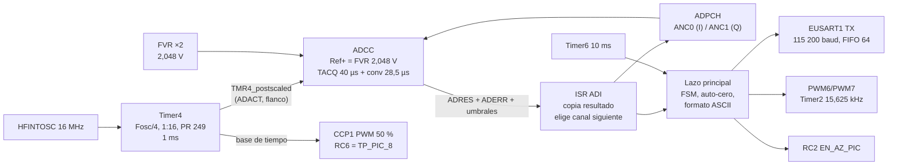

# MACRO · Especificación de diseño definitiva y hoja de ruta para MCC

**Proyecto MACRO (evolución de Micro 3) · 10 de noviembre de 2026 · Documento de arquitectura, sin código**

MACRO usa la placa Micro 3 tal como se fabricó, con un **PIC16F18446-I/P (PDIP-20)** en el zócalo `PIC_20pins`. Este documento fija todos los valores que se cargan en MCC y explica por qué se escogió cada uno. Está pensado para abrir MCC y copiar módulo por módulo (sección 6).

**Correcciones obligatorias del profesor que este diseño cumple:**

1. **Adquisición 100 % por hardware.** Ninguna conversión la arranca el software. Timer4 dispara por hardware **las dos** conversiones (I y Q) mediante el disparo automático del ADCC. Se elimina el método mixto de Micro 3, donde Timer0 disparaba I y la ISR arrancaba Q con `ADGO = 1`.
2. **Referencia del ADC = FVR interna.** `ADPREF` = FVR, con el buffer del FVR en **2,048 V**. Se abandona `VREF+ = VDD`.

**Restricciones adicionales indicadas por el equipo (10/11/2026):**

- **Sin watchdog** (`WDTE = OFF`), por indicación del profesor.
- **Sin promedio de muestras.** El ADCC trabaja en modo básico, con una conversión por disparo. No se usan los modos Accumulate, Average, Burst Average ni Low-pass filter, y ninguna muestra se promedia en el PIC.
- **El único código de Micro 3 que se puede reutilizar es el de la USART** (`eusart1.c` / `eusart1.h` con los cambios C-06 a C-10, y las dos ramas TX/RX de la ISR). Todo lo demás se hace nuevo para MACRO: ADC, timers, PWM, formato ASCII, máquina de estados, `main` y el resto del código de MCC. Detalle en R9 (§2) y §6.10.
- Se mantienen las reglas de Micro 3: MCC como base, ninguna espera bloqueante en la lógica, una sola ISR, UART por interrupciones con FIFO circular, `tx_DAT` / `tx_string`, envío en texto ASCII y `LVP` habilitado.

**Fuentes de este documento:** `Esquematico_micro3.SchDoc` y `Micro3_para_fabricacion.PcbDoc` (nets extraídas de los archivos adjuntos), `Micro3_contextualizacion_final_funcionamiento_y_uso.md`, el repositorio `juancalderonlaratilin-ai/micro3` (commit `76e1109`, firmware y `docs/`) y la documentación de Microchip y Silicon Labs listada en la sección 14.

---

## 0. Resumen de valores (tabla de una página)

| Bloque | Valor definitivo | Motivo en una línea |
|---|---|---|
| Microcontrolador | PIC16F18446-I/P, PDIP-20, alimentado a 3,7 V desde `VDD_D` | Es el que está montado en la PCB. La versión F admite 2,3–5,5 V |
| Oscilador | HFINTOSC **16 MHz**, `NDIV` 1:1 → `TCY` = 250 ns | Da PWM de 15,625 kHz con 10 bits (filtros de la PCB) y 115 200 baud con `SP1BRG` = 34, como Micro 3 |
| Referencia ADC | **FVR ×2 = 2,048 V** (`ADPREF` = FVR, `ADNREF` = VSS) | Exigido. 1,024 V queda bajo el mínimo de 1,8 V de VREF y 4,096 V necesita VDD ≥ 4,75 V |
| Resolución ADC | 12 bits, LSB = **0,500 mV**, σq = 144 µV | 2,048 V / 4096 |
| Disparo ADC | **Timer4 postscaled**, cada **1 ms** (1 kHz), `ADACT` = TMR4 | 100 % hardware, sin la ambigüedad de flanco de Timer0 |
| Muestreo por canal | **500 muestras/s de I y 500 muestras/s de Q**, intercaladas (I en t, Q en t + 1 ms) | Indicación del profesor (1000 conversiones/s en total). Nyquist cubierto por el filtro de 5,1 Hz (−68 dB en fs/2 = 250 Hz) |
| Reloj ADC | Fosc/32 → `TAD` = 2 µs; conversión 14·TAD + 2·TCY = 28,5 µs | Dentro de AD20 (0,5–9 µs), igual que Micro 3 |
| Adquisición | `ADACQ` = 640 ciclos de Fosc = **40 µs** | Cubre `TACQ` ≈ 6,3 µs y recupera C22 tras la carga compartida (−86 dB) |
| Modo ADCC | Básico, sin promedio. Cálculo de error contra consigna 2048 y umbrales de saturación por hardware | La detección de saturación queda en el periférico |
| PWM auto-cero | PWM6 → RA2 (I0), PWM7 → RA4 (Q0), Timer2, `T2PR` = 255, 1:1 → **15,625 kHz, 10 bits** | Es la portadora para la que se calcularon R50–R63/C50–C61 |
| Base de tiempo | Timer6 → **10 ms** con interrupción | Esperas de 500 ms, antirrebote y LED sin bloquear |
| Reloj de muestreo visible | CCP1 en PWM sobre Timer4, 1 kHz al 50 % en RC6 (TP_PIC_8) | Permite ver y medir con el osciloscopio el instante de disparo, sin software |
| UART | EUSART1 **115 200 baud 8N1**, `BRG16 = 1`, `BRGH = 1`, `SP1BRG` = 34 (114 286 real, −0,79 %) | Envía los 500 pares/s con 48,1 % de ocupación. Es el enlace ya probado en Micro 3 |
| Formato | `IIII,QQQQ\r\n` (≤ 11 bytes) 500 líneas/s + mensajes `S:` / `OK:` / `E:` | Mismo formato y tasa que el receptor ASCII de Micro 3 |
| Watchdog | **Apagado** | Indicación del profesor |
| BOR | Activo, umbral alto | Reinicia antes de que VDD caiga bajo los 2,5 V que exige el FVR de 2,048 V |

---

## 1. Qué cambia respecto de Micro 3

| Tema | Micro 3 (firmware del repositorio) | MACRO | Motivo |
|---|---|---|---|
| Chip | PIC16F18426, 14 pines | **PIC16F18446, 20 pines** | Es el chip de la PCB fabricada. Cambian los números de pin y el PPS por defecto de RX1 (§3.3) |
| Referencia ADC | `VDD` = 3,7 V (`ADREF = 0x00`) | **FVR 2,048 V** (`ADREF = 0x03`) | Corrección 2 del profesor |
| Disparo de I | Timer0 por hardware | Timer4 por hardware | — |
| Disparo de Q | **ISR con `ADGO = 1`** (método mixto) | **Timer4 por hardware** | Corrección 1. Se elimina el jitter de latencia de interrupción de Q (en Micro 3 podía costar hasta 61 dB a 20 Hz) |
| Ritmo del ADC | 1 disparo/ms con ráfaga I→Q (1000 I + 1000 Q por segundo) | 1 disparo cada 1 ms, alternando I y Q (**500 I + 500 Q por segundo**) | Indicación del profesor. Con un solo `ADACT` es la única forma de que ambos canales se disparen por hardware sin lógica extra |
| Uso del PWM | Reconstrucción de las muestras | **Auto-cero I0/Q0** (función de la PCB: U3C/U3D, U4, J3) | Lo que se había aplazado a Macro |
| RC2 | Salida de prueba de Timer0 | **`EN_AZ_PIC`** (selección de U4) | En la PCB nueva es el control del auto-cero |
| Pin de prueba del muestreo | RC2 = TMR0_out | **RC6 = CCP1** (onda de 1 kHz alineada con el disparo) | RC6 tiene pad (TP_PIC_8) y está libre |
| UART | 115 200 baud; muestreaba 1000 pares/s y enviaba 1 de cada 2 (500 líneas/s) | **115 200 baud, todos los pares (500 líneas/s)** | Ahora el ADC muestrea exactamente lo que se envía, sin descartar muestras. Baud y tasa iguales a Micro 3: el PC casi no cambia |
| Filtro anti-aliasing | No había | **Sallen-Key de 2.º orden en la PCB, −3 dB ≈ 5,1 Hz** | Ya está montado en Micro 3 (U2A/U2B) |
| Promedio | No | No | Se mantiene |
| Watchdog | Apagado | Apagado | Se mantiene |
| Código | `adc_iq`, `adc_ascii`, `pwm`, `main`, `eusart1` y código de MCC para el 18426 | **Solo se reutiliza `eusart1.c/.h`**; el resto se escribe o se genera de nuevo | Restricción del equipo (R9) |

---

## 2. Restricciones y reglas que gobiernan el diseño

| # | Regla | Cómo se cumple |
|---|---|---|
| R1 | Disparo y recolección del ADC a nivel de hardware | `ADACT` = TMR4. El software **nunca** escribe `ADGO` y no hay polling de conversión. El instante de muestreo lo fija Timer4 y la conversión, el resultado, el error contra la consigna y la comparación de umbrales los hace el ADCC (§4.2) |
| R2 | Referencia ADC = FVR | `ADPREF` = FVR, `ADFVR` = 2x. Se espera `FVRRDY` antes de arrancar Timer4 |
| R3 | Sin watchdog | `WDTE = OFF`. La recuperación ante fallos se hace con la máquina de estados, el BOR, SW1 y R8 (§7.6) |
| R4 | Sin promedio | ADCC en modo básico (`ADMD` = Basic). Cada línea lleva una conversión cruda de I y una de Q |
| R5 | Sin esperas bloqueantes en la lógica | Toda espera usa el tick de Timer6 en la máquina de estados |
| R6 | Una sola ISR, con bandera **y** habilitación comprobadas | MCC Interrupt Manager, orden de atención en §7.1 |
| R7 | UART no bloqueante con FIFO circular, `tx_DAT` y `tx_string` | Igual que T-03 de Micro 3, buffers TX 64 / RX 32 |
| R8 | Nyquist y filtro anti-aliasing (enunciado §3.2) | `fs` = 500 Hz por canal frente a un filtro de 5,1 Hz que atenúa −68 dB en `fs/2` = 250 Hz (§8.4) |
| R9 | **Solo se reutiliza el código de la USART de Micro 3** | Se reutilizan `eusart1.c` y `eusart1.h` (FIFO circular sin contador, TX 64 / RX 32, `EUSART1_Write`/`EUSART1_Read` sin espera, `tx_DAT` todo o nada, `tx_string`, cambios C-06 a C-10) y las llamadas directas a `EUSART1_Transmit_ISR` / `EUSART1_Receive_ISR` en la ISR. **No se reutilizan** `adc_iq.*`, `adc_ascii.*`, `pwm.*`, `main.c` ni los archivos de MCC del PIC16F18426 (`adcc.*`, `tmr0.*`, `pin_manager.*`, `mcc.c`, `device_config.*`): esa lógica corresponde al método mixto, a la referencia VDD o al chip de 14 pines. El procedimiento está en §6.10 |

> **Límite físico del chip, para defender R1 ante el profesor.** El PIC16F18446 tiene un solo ADCC, sin DMA y sin secuenciador de canales. El multiplexor (`ADPCH`) solo lo puede cambiar la CPU. En MACRO la CPU **no** decide cuándo se muestrea ni arranca conversiones. Su única intervención es copiar `ADRES` al buffer y dejar elegido en `ADPCH` el canal del **siguiente** disparo, con 931 µs de margen antes de que llegue. El instante de muestreo de I y de Q depende solo de Timer4 y del oscilador.

---

## 3. Asignación de pines (extraída de la PCB)

### 3.1 PIC16F18446 en `PIC_20pins`

Nets leídas de los pads de `Micro3_para_fabricacion.PcbDoc` (componente `PIC_20pins`) y cotejadas con el documento de contextualización. Coinciden pin a pin.

| Pin físico | Puerto | Net en la PCB | Conecta con | Función en MACRO | Periférico / modo |
|---:|---|---|---|---|---|
| 1 | VDD | `VDD_D` | J1.1, C3/C4/C5, J4.2, TP_VDD | Alimentación 3,7 V | — |
| 2 | RA5 | `LED_STATUS` | R6 2,2 kΩ → D3 → JP_LED | LED de estado (alto = encendido) | Salida digital |
| 3 | RA4 | `PWM_Q` | R60 → red RC → U3D → U4 | PWM del comando Q0 | **PWM7** por PPS |
| 4 | RA3/MCLR | `MCLR` | R3 10 kΩ a VDD_D, SW1, J4.1, TP_MCLR | Reset y programación | MCLR (LVP) |
| 5 | RC5 | `PIC_RX` | JP_RX ← R14 ← U6 (CP2102 TXD); J6.3; R18 | Recepción UART | **RX1** por PPS (no es el valor por defecto en 20 pines) |
| 6 | RC4 | `PIC_TX` | U5 (A) → CP2102 RXD, J6.2, R15 | Transmisión UART | **TX1** por PPS |
| 7 | RC3 | `AZ_BUTTON` | R5 1 kΩ ← SW2; R4 10 kΩ a VDD_D; C6 100 nF | Pulsador de auto-cero (bajo = pulsado) | Entrada digital |
| 8 | RC6 | `EXP_RC6` | TP_PIC_8 | Reloj de muestreo visible (validación) | **CCP1** PWM por PPS |
| 9 | RC7 | `EXP_RC7` | TP_PIC_9 | Marcador de ISR (solo validación) | Salida digital |
| 10 | RB7 | `EXP_RB7` | TP_PIC_10 | Reservado | Salida en 0 |
| 11 | RB6 | `EXP_RB6` | TP_PIC_11 | Reservado | Salida en 0 |
| 12 | RB5 | `EXP_RB5` | TP_PIC_12 | Reservado | Salida en 0 |
| 13 | RB4 | `EXP_RB4` | TP_PIC_13 | Reservado | Salida en 0 |
| 14 | RC2 | `EN_AZ_PIC` | R9 1 kΩ → JP_AZEN.3 → `AZ_SEL` (U4.10/11, R8 47 kΩ a GND) | Habilita comandos PWM hacia J3 | Salida digital, arranca en 0 |
| 15 | RC1 | `ADC_Q` | R38 1 kΩ / C32 10 nF ← JP_ADC_Q; TP_ADC_Q | Entrada analógica Q | **ANC1** (`ADPCH` = 0x11) |
| 16 | RC0 | `ADC_I` | R28 1 kΩ / C22 10 nF ← JP_ADC_I; TP_ADC_I | Entrada analógica I | **ANC0** (`ADPCH` = 0x10) |
| 17 | RA2 | `PWM_I` | R50 → red RC → U3C → U4 | PWM del comando I0 | **PWM6** por PPS |
| 18 | RA1 | `ICSPCLK` | J4.5 | Programación/depuración | No usar |
| 19 | RA0 | `ICSPDAT` | J4.4 | Programación/depuración | No usar |
| 20 | VSS | `GND` | J1.2, polígonos Top/Bottom | Retorno | — |

### 3.2 Conectores y jumpers que afectan al firmware (también leídos de la PCB)

| Elemento | Pines y nets | Importancia para MACRO |
|---|---|---|
| J1 | 1 `VDD_D`, 2 `GND` | Fuente de 3,7 V común con práctica 2 |
| J2 (JST XH 6) | 1 GND, 2 `VI_CABLE`, 3 GND, 4 `VQ_CABLE`, 5 `VREF2_CABLE`, 6 GND | I/Q desde práctica 2 |
| J3 (JST XH 4) | 1 `I0_CMD`, 2 GND, 3 `Q0_CMD`, 4 GND | Comandos de auto-cero hacia práctica 2 |
| J4 (SNAP) | 1 MCLR, 2 VDD_D, 3 GND, 4 ICSPDAT, 5 ICSPCLK | Programación |
| J5 (JST XH 5) | 1 GND, 2 `CP_TX`, 3 `CP_RX`, 4 `USB_3V3_IN`, 5 GND | CP2102 externo |
| J6 | 1 GND, 2 `PIC_TX`, 3 `PIC_RX` | UART directa al dominio del PIC |
| J7 | 1/3/5 GND, 2 `TEST_I`, 4 `TEST_Q` | Generador para SINAD y ruido |
| JP_IN_I / JP_IN_Q | 1 cable · 2 `AA_x_IN` · 3 `TEST_x_ISO` | 1–2 práctica 2, 2–3 generador J7 |
| JP_ADC_I / JP_ADC_Q | 1 `AA_x_OUT` (filtro) · 2 `ADC_x_SRC` · 3 `AA_x_IN` (bypass) | 1–2 con anti-aliasing, 2–3 bypass para SINAD del ADC solo |
| JP_AZEN | 1 GND · 2 `AZ_SEL` · 3 `EN_AZ_LIMIT` | 1–2 reposo forzado, 2–3 control por RC2 |
| JP_AZ_I / JP_AZ_Q | `AZ_x_ISO` ↔ `x0_CMD` | Conectan los comandos a J3 |
| JP_TX / JP_RX | Ruta UART hacia/desde U5/U6 | Cerrados en operación normal |
| U4 (74HC4053D) | 10/11 = `AZ_SEL`; 12/2 = `VREF_BUF` (reposo); 13 = `PWM_I_BUF`, 1 = `PWM_Q_BUF`; 14/15 = salidas | `EN_AZ_PIC` = 0 → J3 = `VREF_BUF`; = 1 → J3 = PWM filtrado |

### 3.3 Avisos de pines propios del encapsulado de 20 pines

- **RX1 no está en RC5 por defecto.** En los dispositivos de 20 pines el valor por defecto de RX1PPS es RB5 (en los de 14 pines era RC5), y la entrada puede venir de los puertos B o C. Hay que asignar RX1 a RC5 en el Pin Manager (RX1PPS = 0x15). El `pin_manager.c` de Micro 3 lo escribía explícitamente, pero un proyecto nuevo de MCC para el 18446 no lo hará si no se elige.
- Tras el reset `ADPCH` = 0x00 = ANA0 = RA0 = ICSPDAT (hallazgo C-12 de Micro 3). Hay que dejar `ADPCH` = ANC0 antes de arrancar Timer4 (§7.3).
- RC2 queda en alta impedancia durante el reset y R8 lleva `AZ_SEL` a reposo. Por eso `LATC2` debe valer 0 **antes** de poner `TRISC2` = 0. MCC escribe LAT antes que TRIS.

---

## 4. Arquitectura de adquisición 100 % por hardware

### 4.1 Diagrama de bloques



### 4.2 Reparto de tareas entre hardware y CPU

| Tarea | Quién la hace | Detalle |
|---|---|---|
| Fijar el periodo de muestreo | **Timer4** (hardware) | Coincidencia `T4TMR` = `T4PR` cada 1 ms, sin recarga por software |
| Arrancar cada conversión (I y Q) | **ADCC** por `ADACT` = TMR4 (hardware) | Un flanco de subida de la fuente seleccionada pone `ADGO` sin intervención del software |
| Adquisición y retención | **ADCC** (hardware) | `ADACQ` = 640 ciclos de Fosc antes de abrir el interruptor de muestreo |
| Conversión SAR de 12 bits | **ADCC** (hardware) | 14 `TAD` + 2 `TCY` |
| Guardar resultado | **ADCC** (hardware) | `ADRES` y, del anterior, `ADPREV` |
| Error contra la consigna 2048 y prueba de umbrales (saturación) | **ADCC, unidad de cálculo** (hardware) | En modo básico el cálculo del error y la comparación se hacen tras cada muestra. Activa `ADTIF` y `UTHR`/`LTHR` sin CPU |
| Mostrar el instante de muestreo en un pin | **CCP1** sobre Timer4 (hardware) | Flanco de subida en RC6 alineado con el reinicio de Timer4 |
| Copiar `ADRES` al buffer y escribir `ADPCH` del próximo canal | CPU, en la ISR ADI | No afecta al instante de muestreo. Plazo: 931 µs |
| Formatear y encolar la línea ASCII | CPU, lazo principal | Sin esperas |

### 4.3 Diagrama de tiempo de una trama (2 ms = un par I, Q)

```text
t (µs)  0        40      68,5 ~75               1000     1040  1068,5 ~1075          2000
        |--ACQ I--|-CONV I-|ISR|                  |--ACQ Q--|-CONV Q-|ISR|               |
TMR4    ^ disparo I (hardware)                    ^ disparo Q (hardware)                ^ disparo I
RC6     ‾‾‾‾‾‾‾‾‾‾‾‾‾‾‾‾‾‾‾‾‾‾‾‾‾‾\______________/‾‾‾‾‾‾‾‾‾‾‾‾‾‾‾‾‾‾‾‾‾‾‾‾‾‾\_____________/  (CCP1, 1 kHz, 50 %)
ISR ADI                     I→buf, ADPCH=Q                            Q→buf, ADPCH=I, par listo
Lazo                                                                      formatea "IIII,QQQQ\r\n" (~50–100 µs)
UART TX                                                                   11 bytes a 115 200 = 962,5 µs
```

| Intervalo | Valor | Cálculo |
|---|---:|---|
| Periodo de disparo | 1000 µs | (249 + 1) × 16 × 250 ns |
| Adquisición | 40,0 µs | 640 / 16 MHz |
| Conversión | 28,5 µs | 14 × 2 µs + 2 × 0,25 µs |
| Fin de conversión tras el disparo | 68,5 µs | 40 + 28,5 |
| Margen hasta el siguiente disparo | 931,5 µs | 1000 − 68,5 |
| Desfase I → Q (exacto, fijo) | 1 ms | un periodo de Timer4 |
| Periodo de cada canal | 2 ms (500 Hz) | dos periodos de Timer4 |
| Línea UART | 962,5 µs | 11 × 10 bits / 114 286 baud, menos que los 2 ms entre pares |

### 4.4 Por qué Timer4 y no Timer0 ni Timer2

- **Timer0 no.** `TMR0_out` conmuta en cada coincidencia de `TMR0L` con `TMR0H`, y el disparo automático del ADC responde al **flanco de subida** de la fuente. Con Timer0 el ADC podría dispararse cada dos coincidencias: es la duda abierta 2.1/4.5 de Micro 3. Timer4 elimina la ambigüedad, porque `TMR4_postscaled` con postscaler 1:1 da un pulso en cada periodo. Microchip documenta este uso de Timer2/4/6 como disparo periódico del ADCC.
- **Timer2 no.** Es la base de tiempo de PWM6/PWM7 (64 µs), que no sirve para 1 ms.
- **Timer6** se reserva como tick de 10 ms. **Timer1/3/5** necesitarían recarga por software.

### 4.5 Por qué I y Q intercalados (y cuánto cuesta)

`ADACT` acepta una sola fuente. La única forma de que **cada** conversión la dispare el hardware, sin agregar lógica, es un disparo a 1 kHz que alterna canales: 500 conversiones de I y 500 de Q por segundo. El costo es un desfase **fijo y conocido** de 1 ms entre I y Q:

| Frecuencia de la señal | Desfase de Q | Error relativo máximo |
|---:|---:|---:|
| 1 Hz | 0,36° | 0,63 % |
| 2 Hz | 0,72° | 1,26 % |
| 5 Hz (corte del filtro) | 1,80° | 3,14 % |
| 10 Hz (−12,3 dB en el filtro) | 3,60° | 6,28 % |

La señal útil queda bajo unos 5 Hz por el filtro de la PCB, así que el error es pequeño. Además es determinista, porque no tiene jitter. Si el plano de impedancias lo requiere, el **PC** puede alinear Q con el instante de I por interpolación lineal. Cada canal tiene una muestra cada 2 ms: el error de interpolar es −66 dB a 5 Hz y −82 dB a 2 Hz. Es alineación temporal en el PC, no promedio en el PIC.

*Alternativa descartada:* un segundo disparo retrasado (Timer0 + Timer4 monoestable + CLC en OR) daría un desfase de ~100 µs, pero agrega dos periféricos, un plazo de ISR de unos 60 µs y depende de listas de entradas del CLC no verificadas para este chip.

### 4.6 Adquisición y diafonía entre canales

Fórmula del DS (§32.3, Ec. 32-1): `TACQ = 2 µs + CHOLD·(RIC + RSS + RS)·ln(8191) + 0,05 µs/°C·(T − 25)`, con `CHOLD` = 28 pF, `RIC` = 1 kΩ, `RSS` ≈ 10 kΩ a 3,7 V (conservador) y `RS` = R28 = 1 kΩ.

| Condición | `TACQ` mínimo |
|---|---:|
| 25 °C | 5,03 µs |
| 50 °C | 6,28 µs |
| 85 °C | 8,03 µs |

**El dimensionamiento lo domina C22/C32 (10 nF), no `CHOLD`.** Al conectar `CHOLD`, que todavía tiene la tensión del otro canal, se reparte carga con C22: `k0 = 28 pF / 10,028 nF = 0,28 %` de la diferencia entre canales. C22 se recupera a través de R28 con τ = 10 µs:

| Tiempo de recuperación | Diafonía residual | Error con 2 V de diferencia entre I y Q |
|---:|---:|---:|
| 10 µs (`ADACQ` de Micro 3) | −60 dB | 4,1 LSB |
| **40 µs (MACRO)** | **−86 dB** | **0,21 LSB** |

Si el ADCC sigue conectado al canal nuevo desde que la ISR escribe `ADPCH` (~930 µs antes del disparo), la diafonía es todavía menor. Los 40 µs cubren el caso peor. El tiempo de adquisición del opamp, con salida de baja impedancia, ya no condiciona: R28 lo aísla y C22 actúa como reserva de carga. El datasheet del MCP604 no da un valor de `Zout`.

---

## 5. Referencia FVR: decisión y consecuencias

### 5.1 Por qué 2,048 V

| Opción FVR | ¿Válida a VDD = 3,7 V? | Motivo |
|---|---|---|
| 1,024 V (×1) | **No** | La referencia positiva debe superar a la negativa en al menos 1,8 V |
| **2,048 V (×2)** | **Sí** | Disponible con VDD ≥ 2,5 V. Tolerancia ±4 % de −40 a 85 °C (familia PIC16F184xx) |
| 4,096 V (×4) | **No** | Solo con VDD ≥ 4,5–4,75 V. El FVR no puede superar VDD |

### 5.2 Escala y calibración

| Magnitud | Valor |
|---|---|
| Fondo de escala | 2,048 V nominal (FVR ±4 %) |
| LSB | 0,500 mV (antes 0,903 mV con VDD) |
| Ruido de cuantización ideal | σq = 0,5 mV / √12 = **144 µV** |
| Calibración de fábrica | El DIA guarda la tensión real del FVR ×2 en **FVRA2X, dirección 0x8119, en mV** |
| Conversión a voltios (PIC o PC) | `V = código × FVRA2X / 4096` mV |
| Arranque del FVR | Esperar `FVRRDY` = 1. Tiempo típico de arranque: 60 µs (dato de la familia) |

El PIC lee FVRA2X al arrancar y lo envía en el mensaje `S:MACRO,FVR=<mV>`. El PC usa ese valor como `VREF`, así corrige el ±4 % sin un trimmer.

### 5.3 Consecuencia sobre el auto-cero: el centro pasa a 1,024 V

Con VDD como referencia el reposo de I/Q era `Vref2` ≈ 1,85 V. Con FVR, **1,85 V queda a 0,2 V del fondo de escala**. MACRO fija la **consigna del auto-cero en el código 2048 = 1,024 V**, el centro de la nueva escala, con ±1,024 V de excursión simétrica.

- Rango de comando disponible (doc. de contexto §8.3): `V_PWM_BUF` de 1,3875 V (n = 0) a 2,3116 V (n = 1023).
- Desplazamiento necesario de I0 frente al caso de 1,85 V: (1,85 − 1,024) / G = **+82,6 mV con G = 10** o **+41,3 mV con G = 20**. Cabe con holgura en el rango.
- Paso de un código PWM en el comando: 0,9033 mV. En la salida de práctica 2: 9,03 mV (G = 10) = **18 códigos** o 18,07 mV (G = 20) = **36 códigos**. El residuo del auto-cero queda dentro de ±½ paso y se guarda como línea base.
- **En REPOSO** (`EN_AZ_PIC` = 0, comandos = `VREF_BUF`), I/Q pueden saturar en 4095. Es normal: el ADC no se daña (la tensión del pin queda ≤ VAA) y el auto-cero converge porque conoce el signo.
- La cadena analógica admite el centro de 1,024 V: la entrada de U2 queda en 0,63 V ± 0,63 V, dentro del modo común del MCP604 (hasta VAA − 1,2 V), y la salida rail-to-rail cubre 0–2,048 V.

### 5.4 Lo que se gana y lo que se pierde

| | Efecto |
|---|---|
| **Gana** | La escala del ADC deja de depender de VDD, que comparten el PIC, práctica 2 y las cargas digitales (LED, UART, PWM). El rizado rápido de VDD ya no modula la ganancia del ADC. La resolución en voltios mejora 1,8 veces (0,5 mV) y la medida pasa a ser absoluta y calibrada por el DIA |
| **Pierde** | La cancelación ratiométrica: `Vref2` = VDD/2 sigue al riel y el FVR no. Una deriva **lenta** de VDD de 10 mV mueve el reposo de I/Q unos 5 mV (≈ 10 códigos) |
| **Mitiga** | El auto-cero sobre zona sana al inicio de cada inspección, la línea base restada en el PC, la recalibración cuando cambie la temperatura o el montaje y la fuente de banco. El filtro de 5,1 Hz atenúa la parte rápida |
| **BOR alto** | Si VDD cae bajo ~2,7 V el PIC se reinicia antes de que el FVR de 2,048 V salga de especificación (necesita ≥ 2,5 V) |

### 5.5 Fórmula del duty: relación entre el código del ADC y el PWM

El ADC mide con la regla del FVR (2,048 V), pero el pin del PWM sigue conmutando entre 0 y VDD (3,7 V). Al dejar de compartir la referencia, la conversión de código a duty de Micro 3 (`duty = código / 4`) ya no sirve.

**a) Del duty al voltaje (no depende del FVR)**

| Punto | Fórmula | n = 0 | n = 512 | n = 1023 |
|---|---|---:|---:|---:|
| Pin RA2/RA4, valor medio | `V_pin = (n / 1024) · VDD` | 0 V | 1,850 V | 3,696 V |
| Salida del buffer (TP_PWM, J3) | `V_PWM_BUF = 0,25 · (n / 1024) · VDD + 0,75 · VREF_BUF` | 1,3875 V | **1,850 V** | 2,3116 V |

Con n = 512 el comando sigue centrado en **1,85 V = `VREF_BUF`**, igual que en Micro 3. El FVR no cambia el PWM.

**b) Del código del ADC al voltaje (sí depende del FVR)**

`Vin = código × FVRA2X / 4096`, con FVRA2X en mV (≈ 2048), leído del DIA en 0x8119.

**c) Fórmula del duty para que el PWM siga la señal del ADC (copia en el pin)**

Igualando `V_pin = Vin`:

`n = código × FVRA2X / (4 × VDD_mV)`  ⇒ con valores nominales `n = código × 2048 / 14 800 ≈ código × 0,1384`

| Entrada | Código ADC | Duty `n` | `V_pin` resultante | Error |
|---:|---:|---:|---:|---:|
| 0 V | 0 | 0 | 0 V | 0 |
| 0,500 V | 1000 | 138 | 0,4986 V | −1,4 mV |
| 1,024 V | 2048 | 283 | 1,0226 V | −1,4 mV |
| 2,0475 V (tope) | 4095 | 566 | 2,0451 V | −2,4 mV |

- **Por qué no `código / 4`:** daría `V_pin` = 3,7 / 2,048 = **1,81 veces** la entrada.
- **Versión entera para el firmware (sin coma flotante):** `n = (código × K) >> 16`, con `K = round(65 536 × FVRA2X / (4 × VDD_mV))`. Con los valores nominales `K` = **9069**. El producto máximo, 4095 × 9069 = 37 137 555, cabe en un entero sin signo de 32 bits. El error por truncar es ≤ 1 paso de duty. `K` se calcula una vez al arrancar, con FVRA2X del DIA y VDD medido con multímetro como constante.
- **Resolución de la copia:** solo se usan los duty 0–566. Cada paso del PWM vale 3,6 mV (unos 7 códigos del ADC), así que la copia tiene ~9,1 bits efectivos.
- **Sin compensación ratiométrica:** si VDD real ≠ `VDD_mV`, la copia se desvía en la misma proporción (1 % de VDD = 1 % de error).
- **Dónde se ve:** la copia fiel solo existe en el pin filtrado (RA2/RA4 + RC). En TP_PWM y J3 el buffer la comprime a 1,39–2,31 V según la fórmula (a).

**d) Relación que usa el auto-cero (lazo cerrado)**

El auto-cero no necesita la fórmula (c): solo compara el código con 2048 y sube o baja el duty, así que absorbe solo cualquier error de FVR o VDD. Para fijar `TOL_AZ` basta saber cuánto mueve un paso del PWM la lectura del ADC:

`Δcódigo por paso PWM = G × 0,25 × VDD / 1024 ÷ (FVRA2X / 4096) = G × VDD / FVRA2X ≈ 1,807 × G`

Eso da **18 códigos** con G = 10 y **36 códigos** con G = 20. Con VDD de referencia eran 10 y 20; ahora cada paso se ve 1,8 veces más grande porque la regla del ADC es más corta.

---

## 6. Configuración en MCC, módulo por módulo

> **Cómo usar esta sección.** Crear un proyecto **nuevo** en MPLAB X 6.x con el dispositivo **PIC16F18446** y XC8 2.40–2.45. El de Micro 3 está hecho para el PIC16F18426 y no sirve tal cual. Abrir MCC Classic, el mismo que se usó en clase, agregar los módulos en este orden y cargar los valores de cada tabla. Los nombres de los campos son los habituales de MCC Classic y pueden variar ligeramente según la versión. La columna **Comprobar** da el valor que debe aparecer en el código generado: si no coincide, el campo quedó mal.

### 6.1 System Module · Oscilador

| Campo | Valor | Por qué | Comprobar |
|---|---|---|---|
| Oscillator Select | HFINTOSC | Sin cristal. La PCB no tiene oscilador externo | `OSCCON1` = 0x60 |
| HF Internal Clock | 16 MHz | PWM de 15,625 kHz con 10 bits y `T2PR` = 255, y 115 200 baud con `SP1BRG` = 34 (valor probado en Micro 3) | `OSCFRQ` = 0x05 |
| Clock Divider | 1 | Fosc = 16 MHz, `TCY` = 250 ns | — |
| PLL | No | No hace falta más velocidad. Menos ruido y menos consumo | — |
| Low-voltage Programming | Habilitado | Obligatorio con SNAP, RA3 = MCLR | `LVP = ON` |

### 6.2 System Module · Bits de configuración

| Palabra | Campo | Valor | Por qué |
|---|---|---|---|
| CONFIG1 | FEXTOSC | OFF (oscilador externo deshabilitado) | Libera RA4 y RA5 |
| | RSTOSC | HFINTOSC 1 MHz | Arranque limpio. El código pasa a 16 MHz (Micro 3 §4.2) |
| | CLKOUTEN | OFF | RA4 es PWM7 |
| | CSWEN | ON | Permite cambiar `NOSC` |
| | FCMEN | OFF | Decisión C-02 de Micro 3 |
| CONFIG2 | MCLRE | ON (MCLR) | SW1 y R3 |
| | PWRTS | 16 ms | Margen de arranque. Se evita la opción de 64 ms por la errata 1.11.1 en silicio A1 |
| | LPBOREN | OFF | No hace falta BOR de bajo consumo |
| | BOREN | ON (siempre activo) | Protección ante caídas de la fuente compartida |
| | BORV | Umbral **alto** (≈ 2,7 V en la versión F; confirmar el texto que muestre MCC) | El FVR de 2,048 V necesita VDD ≥ 2,5 V |
| | ZCD | Deshabilitado | No se usa |
| | PPS1WAY | OFF | Decisión C-01 de Micro 3: PPS reconfigurable |
| | STVREN | ON | Reset por desbordamiento de pila |
| CONFIG3 | WDTE | **OFF** | Indicación del profesor. WDTCPS, WDTCWS y WDTCCS quedan sin efecto |
| CONFIG4 | BBEN, SAFEN, WRTx | OFF | Sin bootloader ni protección de escritura |
| | LVP | ON | SNAP |
| CONFIG5 | CP | OFF | Lectura del programa habilitada en desarrollo |

### 6.3 FVR

| Campo | Valor | Por qué | Comprobar |
|---|---|---|---|
| Enable FVR | Sí | Corrección 2 del profesor | `FVRCON.FVREN` = 1 |
| FVR_buffer1 Gain (ADC) | **2x (2,048 V)** | §5.1 | `FVRCON.ADFVR` = 10 |
| FVR_buffer2 Gain (Comparador/DAC) | Off | No se usa. Ahorra consumo | `CDAFVR` = 00 |
| Temperature indicator | Deshabilitado | No se usa | `TSEN` = 0 |
| | | | `FVRCON` = **0x82** |

Para leer FVRA2X (DIA, 0x8119) se agrega además el módulo **Memory (NVM)** de MCC. Solo se usa para esa lectura, con acceso al DIA por `NVMREGS` = 1.

### 6.4 ADCC (ADC2)

| Campo | Valor | Por qué | Comprobar |
|---|---|---|---|
| Enable ADC | Sí | — | `ADCON0.ADON` = 1 |
| Clock Source | FOSC/ADCLK | Reloj síncrono y determinista | `ADCON0.ADCS` = 0 |
| Clock divider | **FOSC/32 → TAD = 2 µs** | Dentro de AD20 (0,5–9 µs). Conversión de 28,5 µs | `ADCLK` = 0x0F |
| Result Alignment | Right | Código directo 0–4095 | `ADCON0.ADFM` = 1 → `ADCON0` = **0x84** |
| Positive Reference | **FVR** | Corrección 2 | `ADREF.ADPREF` = 11 |
| Negative Reference | VSS | — | `ADREF` = **0x03** |
| Auto-conversion Trigger | **TMR4** (postscaled) | Disparo 100 % hardware (§4) | `ADACT` = **0x06** |
| Operating Mode | **Basic mode** | Sin promedio (restricción del equipo) | `ADCON2.ADMD` = 000 |
| Continuous operation | No | Una conversión por disparo | `ADCON0.ADCONT` = 0 |
| Acquisition Count | **640** (MCC debe mostrar 40 µs) | §4.6. Ver la prueba V3 | `ADACQH:ADACQL` = 0x02:0x80 |
| Precharge Count | 0 | Sin precarga. C22/C32 aportan la carga | `ADPRE` = 0 |
| Additional S&H capacitance | 0 | La capacidad extra alarga el asentamiento | `ADCAP` = 0 |
| Repeat count | 0 | Sin ráfagas ni promedio | `ADRPT` = 0 |
| Double sampling | Deshabilitado | Evita la errata 1.1.2 | `ADCON1` = 0x00 |
| Guard ring / CVD | Deshabilitado | No es medición capacitiva | `ADCON1` = 0x00 |
| Error calculation mode | **Actual result vs setpoint** | El hardware calcula `ADERR` = `ADRES` − `ADSTPT` en cada muestra | `ADCON3.ADCALC` |
| Setpoint | **2048** | Consigna del auto-cero (centro de la escala FVR) | `ADSTPT` = 0x0800 |
| Upper threshold | **+2039** | `ADERR` > 2039 ⇔ código ≥ 4088 → saturación alta | `ADUTH` = 0x07F7 |
| Lower threshold | **−2040** | `ADERR` < −2040 ⇔ código ≤ 7 → saturación baja | `ADLTH` = 0xF808 |
| Threshold Interrupt Mode | **ADERR < ADLTH o ADERR > ADUTH** | Marca la saturación en hardware (`ADTIF`, `UTHR`/`LTHR`) | `ADCON3.ADTMD` |
| ADC Threshold Interrupt (ADTI) | **Deshabilitado** | `ADTIF` funciona como bandera pegajosa que la ISR ADI consulta. Sin fuente extra en la ISR | `PIE1.ADTIE` = 0 |
| ADC Interrupt (ADI) | **Habilitado** | Fin de conversión → copiar resultado y elegir canal | `PIE1.ADIE` = 1 |
| Canales (Pin Manager) | ANC0 = RC0 (I), ANC1 = RC1 (Q) | PCB | `ADPCH` 0x10 / 0x11 |

> MCC no deja `ADPCH` en ANC0 al iniciar (queda en ANA0 = ICSPDAT). La máquina de estados lo fija antes de arrancar Timer4 (§7.3).
>
> Si en este chip el signo de `ADERR` resultara invertido (`ADSTPT` − `ADRES`), no cambia nada: los umbrales casi simétricos detectan igual las dos saturaciones (solo se intercambian `UTHR` y `LTHR`) y la prueba V8 absorbe el signo en `SIGNO_x`.

### 6.5 TMR4 · Disparo del ADC

| Campo | Valor | Por qué | Comprobar |
|---|---|---|---|
| Enable Timer | **No** al iniciar | Lo arranca PREPARAR cuando FVR y `ADPCH` estén listos | `T4CON.ON` = 0 → `T4CON` = 0x40 |
| Control Mode | Roll over pulse (free running) | Periodo fijo sin software | `T4HLT` = 0x00 |
| Start/Reset Option | Software control | Sin reset externo | `T4RST` = 0x00 |
| Clock Source | FOSC/4 | 4 MHz | `T4CLKCON` = 0x01 |
| Prescaler | 1:16 | 4 µs por cuenta | `CKPS` = 100 |
| Postscaler | **1:1** | Un disparo en cada periodo | `OUTPS` = 0000 |
| Timer Period | **1 ms** | 1 kHz de disparos = 500 I + 500 Q por segundo | `T4PR` = **249** (0xF9) |
| Interrupt | Deshabilitada | Solo dispara el ADC | `PIE4.TMR4IE` = 0 |

### 6.6 TMR2 · Base del PWM de auto-cero

| Campo | Valor | Por qué | Comprobar |
|---|---|---|---|
| Enable Timer | Sí | — | `T2CON.ON` = 1 |
| Control Mode | Roll over pulse | — | `T2HLT` = 0x00 |
| Clock Source | **FOSC/4** | El PWM exige Fosc/4. El valor de reset es el pin externo y no contaría | `T2CLKCON` = 0x01 |
| Prescaler / Postscaler | 1:1 / 1:1 | Máxima resolución | `T2CON` = 0x80 |
| Timer Period | **64 µs** | 15,625 kHz, la portadora para la que se calcularon los filtros R50–R63/C50–C61 | `T2PR` = **255** |
| Interrupt | Deshabilitada | El PWM corre solo | — |

### 6.7 PWM6 (I0) y PWM7 (Q0)

| Campo | PWM6 | PWM7 | Por qué | Comprobar |
|---|---|---|---|---|
| Enable | Sí | Sí | — | `PWMxCON` = 0x80 |
| Timer | Timer2 | Timer2 | Valor de reset de `CCPTMRS1` | `P6TSEL`/`P7TSEL` = 01 |
| Polaridad | Activa en alto | Activa en alto | `V_media = d·VDD` | `POL` = 0 |
| Duty inicial | **50 % (código 512)** | **50 % (código 512)** | `V_PWM_BUF` = 0,25·0,5·3,7 + 0,75·1,85 = **1,850 V** = `VREF_BUF`: comando neutro | `PWMxDCH` = 0x80, `PWMxDCL` = 0x00 |
| Resolución | 10 bits (0–1023) | 10 bits | 4·(255 + 1) = 1024 pasos de 0,9033 mV en `PWM_x_BUF` | — |
| Pin | **RA2** (pin 17) | **RA4** (pin 3) | PCB | `RA2PPS` = 0x0D, `RA4PPS` = 0x0E |

### 6.8 TMR6 · Tick de 10 ms

| Campo | Valor | Por qué | Comprobar |
|---|---|---|---|
| Enable Timer | Sí | — | `T6CON.ON` = 1 |
| Clock Source | FOSC/4 | — | `T6CLKCON` = 0x01 |
| Prescaler | 1:64 | 16 µs por cuenta | `CKPS` = 110 |
| Timer Period | 2 ms | — | `T6PR` = **124** |
| Postscaler | 1:5 | 2 ms × 5 = **10 ms** | `OUTPS` = 0100 → `T6CON` = **0xE4** |
| Interrupt | **Habilitada** | La ISR solo cuenta ticks. Las esperas de la FSM se miden en ticks | `PIE4.TMR6IE` = 1 |

Usos del tick: espera de asentamiento del auto-cero, 50 ticks = 500 ms; antirrebote de SW2, 3 ticks = 30 ms; persistencia de alarma, 10 ticks = 100 ms; parpadeo del LED.

### 6.9 CCP1 · Reloj de muestreo visible (validación)

| Campo | Valor | Por qué | Comprobar |
|---|---|---|---|
| CCP Mode | PWM | Onda cuadrada generada solo por hardware | `CCP1CON` = 0x8F |
| Timer | **Timer4** | Misma base que el disparo del ADC: el flanco de subida coincide con el reinicio de Timer4 | `CCPTMRS0.C1TSEL` = Timer4 |
| Duty | 50 % | Periodo de 4·(249 + 1) = 1000 cuentas | `CCPR1` = 500 (0x01F4), alineado a la derecha |
| Pin | **RC6** (pin 8, TP_PIC_8) | Pad libre | `RC6PPS` = 0x09 |
| Resultado | 1 kHz, flanco de subida = disparo de I o de Q | Para medir el periodo y su histograma con osciloscopio | — |

Es opcional en la versión de entrega. Si se quita, RC6 queda como salida digital en 0.

### 6.10 EUSART1

| Campo | Valor | Por qué | Comprobar |
|---|---|---|---|
| Mode | Asynchronous | — | `TX1STA.SYNC` = 0 |
| Enable EUSART / Transmit / Receive | Sí / Sí / Sí (continuous receive) | Comandos del PC y datos | `RC1STA` = 0x90 |
| Baud Rate | **115 200** | §8.2 | `SP1BRGL` = **34** (0x22), `SP1BRGH` = 0 |
| BRG16 / BRGH | 16 bits / alta velocidad | `Baud = Fosc / [4·(n + 1)]` = 16 MHz / 140 = 114 286 (−0,79 %); MCC debe mostrar ese error | `BAUD1CON` = 0x08, `TX1STA` = 0x24 |
| Data / Parity / Stop | 8 / ninguna / 1 | 8N1, igual que Micro 3 | — |
| Interrupts | Habilitadas (TX y RX) | FIFO circular, sin bloqueo | `RC1IE` = 1, `TX1IE` solo con datos |
| TX buffer / RX buffer | **64 / 32** bytes | 64 bytes ≈ 5 líneas. RX alcanza para un comando | `EUSART1_TX_BUFFER_SIZE` 64 / RX 32 |
| Redirect STDIO | No | Se usan `tx_DAT` / `tx_string` | — |
| TX pin / RX pin | **RC4** / **RC5** | PCB. RX1 **no** está en RC5 por defecto en 20 pines | `RC4PPS` = 0x0F, `RX1PPS` = 0x15 |

**Reutilización del código de la USART (R9).** Es el único código de Micro 3 que pasa a MACRO. El procedimiento es este:

1. Configurar EUSART1 en MCC para el PIC16F18446 con los valores de la tabla y pulsar *Generate* una vez, con **todos** los módulos de §6 ya cargados.
2. Reemplazar `mcc_generated_files/eusart1.c` y `eusart1.h` por los de Micro 3 (`firmware/Micro_Firmware.X/mcc_generated_files/`), que ya traen C-06 a C-10.
3. Comprobar que en `EUSART1_Initialize` siguen los valores de este proyecto: `BAUD1CON` = 0x08, `RC1STA` = 0x90, `TX1STA` = 0x24, `SP1BRGL` = 0x22, `SP1BRGH` = 0x00. Son los mismos de Micro 3, porque el EUSART1 del 18446 es el mismo módulo y está en el mismo datasheet. Comprobar también los buffers de 64 y 32 bytes.
4. En `interrupt_manager.c` (generado de nuevo) dejar las ramas de RX y TX llamando directamente a `EUSART1_Receive_ISR` y `EUSART1_Transmit_ISR`, en el orden de §6.12.
5. No copiar el `pin_manager.c` de Micro 3. La asignación TX = RC4 y RX = RC5 se hace en el Pin Manager de este proyecto (`RC4PPS` = 0x0F, `RX1PPS` = 0x15).
6. Anotar en `revision_codigo_mcc.md` qué archivos se reemplazaron. Desde ese momento **no se vuelve a pulsar Generate**, porque sobrescribiría `eusart1.c`.

### 6.11 Pin Module

| Pin | Nombre MCC | Dirección | Analógico | Inicio (LAT) | PPS | Nivel de entrada | Slew | WPU |
|---|---|---|---|---|---|---|---|---|
| RA0 | — (ICSPDAT) | entrada | sí (por defecto) | — | — | — | — | no |
| RA1 | — (ICSPCLK) | entrada | sí (por defecto) | — | — | — | — | no |
| RA2 | `PWM_I` | salida | no | 0 | PWM6 | — | limitado | no |
| RA3 | MCLR | entrada | — | — | — | — | — | no |
| RA4 | `PWM_Q` | salida | no | 0 | PWM7 | — | limitado | no |
| RA5 | `LED_STATUS` | salida | no | 0 (apagado) | — | — | limitado | no |
| RB4–RB7 | `EXP_RBx` | salida | no | 0 | — | — | limitado | no |
| RC0 | `ADC_I` | entrada | **sí (ANC0)** | — | — | — | — | no |
| RC1 | `ADC_Q` | entrada | **sí (ANC1)** | — | — | — | — | no |
| RC2 | `EN_AZ_PIC` | salida | no | **0 (reposo)** | — | — | limitado | no |
| RC3 | `AZ_BUTTON` | entrada | no | — | — | Schmitt | — | no (R4 externa) |
| RC4 | TX1 | salida | no | — (lo maneja la EUSART) | TX1 | — | limitado | no |
| RC5 | RX1 | entrada | no | — | **RX1 = RC5** | Schmitt | — | no (R18 externa) |
| RC6 | `SAMPLE_CLK` | salida | no | 0 | CCP1 | — | limitado | no |
| RC7 | `DBG_ISR` | salida | no | 0 | — | — | limitado | no |

Valores esperados en `pin_manager.c`: `TRISA` = 0x0B, `ANSELA` = 0x03, `TRISB` = 0x00, `ANSELB` = 0x00, `TRISC` = 0x2B, `ANSELC` = 0x03, `WPUx` = 0x00, `ODCONx` = 0x00, `LATC2` = 0.

- **RX en Schmitt (y no TTL como en Micro 3).** En la PCB, `PIC_RX` llega desde U6, que trabaja en el dominio `VDD_D`. El nivel alto es VDD completo y Schmitt da más inmunidad al ruido. En Micro 3 el CP2102 de 3,3 V atacaba el pin directamente.
- **Slew limitado en todas las salidas.** Los flancos de PWM, UART e ICSP pueden acoplarse a `ADC_I`/`ADC_Q` (doc. de contexto §19). A 115 200 baud y 15,6 kHz los flancos lentos no afectan.
- **Pines reservados como salidas en 0.** Es el estado definido que pide el doc. de contexto §17: no flotan ni conmutan durante las medidas.

### 6.12 Interrupt Module

| Fuente | Habilitada | Orden de atención en la ISR | Plazo |
|---|---|---|---|
| EUSART1 RX (`RC1IF`) | Sí | 1.º | ~174 µs antes de un overrun (2 bytes de FIFO a 87 µs/byte) |
| ADCC ADI (`ADIF`) | Sí | 2.º | 931 µs hasta el siguiente disparo |
| EUSART1 TX (`TX1IF`) | Sí, solo con datos | 3.º | Ninguno: solo pierde caudal |
| TMR6 (`TMR6IF`) | Sí | 4.º | 10 ms |
| ADTI, TMR2, TMR4, CCP1, IOC | **No** | — | — |

`PEIE` = 1 y `GIE` = 1 se activan **al final** de la inicialización. Cada rama de la ISR comprueba habilitación y bandera (`TX1IF` vale 1 siempre que `TX1REG` esté vacío). La ISR más larga debe durar mucho menos de 174 µs. Si MCC genera las ramas en otro orden, se reordenan en `interrupt_manager.c` y el cambio se anota en `revision_codigo_mcc.md`, como C-11 en Micro 3.

### 6.13 PMD (recomendado)

Dejar habilitados SYSC, **NVM** (lectura del DIA), FVR, ADC, TMR2, TMR4, TMR6, PWM6, PWM7, CCP1 y EUSART1. Deshabilitar TMR0, TMR1, TMR3, TMR5, CCP2–CCP4, CWG1/2, CLC1–4, NCO1, DSM, SMT1, MSSP1/2, CMP1/2, DAC1, ZCD, CLKR e IOC. Así se paran relojes que no se usan cerca del ADC y baja el consumo.

---

## 7. Arquitectura del firmware (sin código)

### 7.1 Responsabilidades de cada parte

| Parte | Hace | No hace |
|---|---|---|
| ISR · RX | Guarda el byte en la FIFO RX y registra `FERR`/`OERR` | Interpretar comandos |
| ISR · ADI | Lee `ADPCH` para saber qué canal terminó, copia `ADRES` y lee y borra `ADTIF` (con `UTHR`/`LTHR`). Escribe en `ADPCH` el otro canal. Al terminar Q publica el par y una marca de saturación | Escribir `ADGO`, esperar, formatear |
| ISR · TX | Pasa el siguiente byte de la FIFO a `TX1REG` o apaga `TX1IE` | — |
| ISR · TMR6 | Incrementa el contador de ticks | Lógica de estados |
| Lazo principal | FSM, auto-cero, comandos, formato ASCII, encolado con `tx_DAT`, LED, pulsador | Esperas bloqueantes |

Identificar el canal leyendo `ADPCH`, en vez de usar una variable de estado, hace que un par mal formado sea detectable: si llegaran dos I seguidas, el par se descarta y se cuenta.

### 7.2 Presupuesto de CPU (4 MIPS)

| Carga | Frecuencia | Estimado |
|---|---:|---:|
| ISR ADI (~40 instrucciones) | 1000/s | ~1 % |
| ISR TX (~25 instrucciones) | 5500/s | ~3,5 % |
| Formato ASCII de un par (~300 instrucciones) | 500/s | ~3,75 % |
| ISR TMR6 + FSM | 100/s | < 1 % |
| **Total** | | **< 10 %** |

Son estimaciones. Se miden con RC7 (prueba V2).

### 7.3 Máquina de estados

| Estado | Al entrar | Mientras está | Sale a |
|---|---|---|---|
| **INICIO** | `SYSTEM_Initialize` (MCC). `EN_AZ_PIC` = 0, PWM 512/512, Timer4 parado | — | PREPARAR |
| **PREPARAR** | — | Espera `FVRRDY` = 1 y 50 ticks (500 ms) para C40/C41, filtros PWM y práctica 2. Lee FVRA2X (0x8119). `ADPCH` = ANC0, borra `ADIF`/`ADTIF`, arranca Timer4. Envía `S:MACRO,FVR=<mV>` | REPOSO |
| **REPOSO** | `EN_AZ_PIC` = 0 (J3 = `VREF_BUF`). Envía `S:REPOSO` | Adquisición y envío activos. Acepta `P:`/`P?` (los PWM se ven en TP_PWM, no en J3) | `Z` o SW2 → HABILITAR; `A:1` → MANUAL |
| **MANUAL** | `EN_AZ_PIC` = 1 con los duty actuales | El PC ajusta I0/Q0 con `P:I,n` / `P:Q,n` (equivale a T-08 de Micro 3) | `A:0` o `R` → REPOSO; `Z` → HABILITAR |
| **HABILITAR** | Duty de partida 512/512. `EN_AZ_PIC` = 1. Envía `S:CAL` | 50 ticks (500 ms) | CALIBRAR |
| **CALIBRAR** | Aproximación sucesiva de 10 bits, I y Q en paralelo, desde el bit 9 | Por paso: fija el duty de prueba, espera 50 ticks, toma **la siguiente muestra** de cada canal (sin promedio) y decide el bit por el signo de `ADERR` × `SIGNO_x`. Envía `S:CAL,<paso>,<dI>,<dQ>` | Tras 10 pasos (5 s) → VALIDAR |
| **VALIDAR** | — | Durante 100 ticks (1 s, 500 muestras por canal) todas las muestras deben quedar dentro de ±`TOL_AZ` del código 2048 y ningún duty puede estar en 0 o 1023 | Cumple → MEDIR con `S:MEDIR,<dI>,<dQ>,<resI>,<resQ>`; no cumple → FALLO |
| **MEDIR** | Duty congelados, datos válidos | Adquisición continua. Saturación persistente (`ADTIF` en ≥ 10 ticks seguidos) → ALARMA | SW2 o `Z` → HABILITAR (invalida la medida); `R` → REPOSO |
| **ALARMA** | `S:ALARMA,<causa>` | Sigue enviando (datos no válidos). Causas: `SAT_I`, `SAT_Q`, `SIN_SENAL` (ambos ≤ 7: cable J2 abierto, porque el divisor R20–R22 lleva la entrada a GND) y `TXOVR` (líneas perdidas por FIFO llena) | 10 ticks sin causa → MEDIR |
| **FALLO** | `EN_AZ_PIC` = 0, PWM 512/512, `S:FALLO,<causa>` (`LIM_I`, `LIM_Q`, `RESIDUO`) | — | REPOSO |

**Parámetros del auto-cero** (constantes que se fijan en la prueba V8):

| Parámetro | Valor de partida | Cómo se fija |
|---|---|---|
| Consigna | 2048 (= `ADSTPT`) | Centro de la escala FVR |
| Espera por paso | 500 ms (50 ticks) | Doc. de contexto §8.4: escalera PWM ~100 ms + filtro I/Q ~0,36 s |
| Pasos | 10 (un bit por paso) | 10 × 0,5 s = **5 s** (criterio de la prueba 5.4: ≤ 5 s) |
| `SIGNO_I`, `SIGNO_Q` | +1 (si el código > 2048, subir el duty) | Se confirma midiendo (subir I0 baja VI_OUT según la ec. 5 del preinforme) |
| `TOL_AZ` | 1 paso PWM medido + 10 códigos (36 + 10 = 46 con G = 20; 18 + 10 = 28 con G = 10) | Paso medido en V8 |

### 7.4 Protocolo serie (115 200 8N1, ASCII)

**Del PIC al PC**

| Línea | Cuándo | Ejemplo |
|---|---|---|
| Datos `I,Q` | Cada par (500/s), primero I | `2051,2046\r\n` |
| Arranque | Una vez | `S:MACRO,FVR=2047\r\n` |
| Estado | Al cambiar de estado | `S:REPOSO\r\n`, `S:MEDIR,541,497,+6,-3\r\n` |
| Progreso de calibración | Cada paso | `S:CAL,4,544,496\r\n` |
| Alarma / fallo | Al ocurrir (máx. 1/s) | `S:ALARMA,SAT_Q\r\n`, `S:FALLO,LIM_I\r\n` |
| Respuesta a comando | Tras cada comando | `OK:I,534\r\n`, `E:rango\r\n` |

Las líneas que empiezan con letra no tienen la forma `número,número` y los lectores de Micro 3 las descartan. El PC etiqueta cada dato con el último `S:` recibido.

**Del PC al PIC** (terminados en `\n`, sin `scanf`)

| Comando | Válido en | Acción |
|---|---|---|
| `Z` | REPOSO, MANUAL, MEDIR | Auto-cero (igual que SW2) |
| `R` | Todos | Vuelve a REPOSO (`EN_AZ_PIC` = 0) |
| `A:1` / `A:0` | REPOSO / MANUAL | Entra y sale de MANUAL |
| `P:I,n` / `P:Q,n` | REPOSO, MANUAL | Duty 0–1023 |
| `P?` | Todos | Responde `P:I,n,Q,m` |

Carga de la línea: 11 bytes × 10 bits × 500/s = 55 000 bit/s, **48,1 %** de 114 286 (cumple el < 50 % de la prueba 6.6). Los mensajes `S:` ocupan menos del 1 %.

### 7.5 LED D3 (RA5) y pulsador SW2 (RC3)

| Estado | LED |
|---|---|
| PREPARAR / REPOSO | Parpadeo de 1 Hz |
| MANUAL | Parpadeo de 2 Hz |
| HABILITAR / CALIBRAR / VALIDAR | Parpadeo de 4 Hz |
| MEDIR | Fijo |
| ALARMA | Doble destello cada segundo |
| FALLO | Parpadeo de 8 Hz durante 2 s, luego REPOSO |

SW2: activo en bajo. Se acepta tras **3 ticks seguidos en 0 (30 ms)** y exige soltarlo antes de aceptar otra pulsación. La red R5/C6 (τ ≈ 0,1 ms) limpia el rebote rápido y el tick resuelve el resto.

### 7.6 Sin watchdog: cómo se cubren los fallos

| Riesgo | Cobertura |
|---|---|
| Firmware colgado con RC2 en alto (U4 sigue entregando PWM) | JP_AZEN en 1–2 fuerza reposo; SW1 reinicia y, durante el reset, RC2 queda en alta impedancia y R8 lleva `AZ_SEL` a reposo |
| Caída de VDD | BOR con umbral alto |
| Desbordamiento de pila | `STVREN` = ON |
| Calibración imposible | Estado FALLO con `EN_AZ_PIC` = 0 |
| Saturación o cable abierto | Estado ALARMA detectado por el umbral de hardware del ADCC |

---

## 8. Presupuestos y justificaciones numéricas

### 8.1 Frecuencias

| Parámetro | Valor | Justificación |
|---|---|---|
| Fosc | 16 MHz | §6.1 |
| Disparo del ADC | 1 kHz (1 ms) | Alterna I y Q |
| `fs` por canal | **500 Hz** (500 I + 500 Q por segundo) | Indicación del profesor. Banda útil < 5 Hz: sobremuestreo de 50 |
| PWM | 15,625 kHz, 10 bits | Filtros de 2 etapas de la PCB (polos de 11,45 y 44,26 Hz) |
| Tick | 100 Hz | Resolución de 10 ms para esperas de 30 ms a 5 s |
| Reloj visible | 1 kHz | Igual que el disparo |

### 8.2 Baud rate

| Opción | `SP1BRG` | Baud real | Error BRG | ¿Caben 500 líneas/s de 11 B? |
|---|---:|---:|---:|---|
| **115 200** | **34** | **114 286** | **−0,79 %** | **Sí: 48,1 % (elegido)** |
| 250 000 | 15 | 250 000 | 0 % | Sí: 22 % (alternativa) |

Se queda en 115 200 porque ya está probado en Micro 3 (pruebas de eco 1.5–1.7), los lectores de Python y LabVIEW ya trabajan a esa velocidad y 500 líneas/s la ocupan al 48,1 %. El error de BRG (−0,79 %) más la tolerancia del HFINTOSC (±2 %) da un peor caso de ≈ −2,8 %, aceptable para 8N1. Si aparecieran errores de trama, se ajusta `OSCTUNE` o se pasa a 250 000: BRG exacto con `SP1BRG` = 15, y el CP2102 incluye 250 000 en su tabla fija de baudios.

### 8.3 Tiempos de software para el diagrama del preinforme

| Tiempo | Valor | Origen |
|---|---:|---|
| Conversión del ADC | 28,5 µs | 14·TAD + 2·TCY |
| Adquisición | 40 µs | `ADACQ` |
| Lectura del ADC (ISR) | ~10 µs (estimado) | Se mide con RC7 |
| Conversión a ASCII de un par | ~50–75 µs (estimado) | Se mide con RC7 |
| Armado y encolado de la trama | ~10 µs (estimado) | Se mide con RC7 |
| Transmisión de la trama | 962,5 µs | 11 bytes a 114 286 baud (cabe en los 2 ms entre pares) |

### 8.4 Nyquist y anti-aliasing (enunciado §3.2)

Respuesta del filtro Sallen-Key de la PCB (f0 = 4,979 Hz, Q = 0,725; mismo modelo que el doc. de contexto §5.2):

| f | 2 Hz | 5 Hz | 10 Hz | 60 Hz | 100 Hz | **250 Hz (fs/2)** | 500 Hz |
|---|---:|---:|---:|---:|---:|---:|---:|
| Ganancia | −0,04 dB | −2,83 dB | −12,3 dB | −43,2 dB | −52,1 dB | **−68,0 dB** | −80,1 dB |

Se cumple `fc` (5,1 Hz) ≤ `fs/2` (250 Hz) con un margen de casi 50 veces. En 250 Hz el filtro atenúa −68 dB: para que una componente ahí produjera 1 LSB (0,5 mV) después del filtro, tendría que llegar con 1,26 V de amplitud, algo que no ocurre en esta cadena. Desde 500 Hz la atenuación supera −80 dB, por debajo del rango dinámico de 12 bits (74 dB). Hay que verificar en banco que el filtro real no tenga un piso de rechazo (paso directo por C20 a alta frecuencia) por encima de −74 dB a 15,6 kHz y 19,2 kHz (prueba 4.7 de Micro 3, ahora sí aplicable).

### 8.5 Jitter de muestreo

Con disparo por Timer4 el jitter es el del oscilador. Límite SNR = −20·log10(2π·f·t_j):

| t_j (rms) | 5 Hz | 20 Hz |
|---:|---:|---:|
| 10 ns | 130 dB | 118 dB |
| 100 ns | 110 dB | 98 dB |
| 1 µs | 90 dB | 78 dB |

Incluso con 1 µs (muy por encima de lo esperable del HFINTOSC) el jitter no limita el SINAD. En Micro 3 el disparo de Q por la ISR podía variar hasta 25 µs (≈ 61 dB a 20 Hz). Esa fuente desaparece.

---

## 9. SINAD: parámetros y procedimiento (se mantiene la métrica de Micro 3)

### 9.1 Definición y requisito

- `SINAD = 20·log10(V_señal,rms / V_(ruido+distorsión),rms)`, sobre los códigos del ADC con una senoidal de entrada. "Ruido + distorsión" es todo lo que no es la fundamental ni la continua.
- `ENOB = (SINAD − 1,76) / 6,02`.
- **Requisito: SINAD > 60 dB (ENOB > 9,67 bits) en I y en Q.** Se mantiene la lectura de Micro 3: es una característica del ADC medida con una senoidal casi a escala completa.

### 9.2 Presupuesto con FVR de 2,048 V

| Concepto | Valor |
|---|---|
| Senoidal a escala completa | 1,024 V pico = 0,724 V rms |
| SINAD ideal de 12 bits | 74,0 dB (σq = 0,289 LSB = 144 µV) |
| Ruido + distorsión máximo para 60 dB | **0,724 mV rms = 1,45 LSB rms** |
| Lo que queda para ruido analógico, FVR, INL/DNL y acoplamientos | **1,42 LSB rms = 0,71 mV rms** (14 dB de margen) |
| Jitter (§8.5) | Despreciable |
| Diafonía I↔Q (§4.6) | −86 dB, despreciable |
| Ruido del FVR | Sin especificar: se mide (§9.5) |
| INL / DNL (AD02/AD03) | ±1 LSB típ. (±2 máx.), aparece como distorsión |
| Ruido de U2 y de las resistencias en 5 Hz | Del orden de µV o menos (incluido el 1/f del MCP604), despreciable frente a 144 µV |

El SINAD depende de la amplitud. Con solo cuantización: 1,024 V pico → 74,0 dB; 0,95 V → 73,4 dB; 0,5 V → 67,8 dB; 0,1 V → 53,8 dB.

### 9.3 Montaje de la prueba

| Prueba | Qué mide | Jumpers | Generador en J7 |
|---|---|---|---|
| **S1 · ADC solo** (criterio) | El conversor con su referencia FVR | JP_IN_x **2–3**, JP_ADC_x **2–3** (bypass), JP_AZEN 1–2, J3 desconectado | Senoidal centrada en **1,024 V**, **0,95 V de amplitud** (0,074–1,974 V, sin recorte), impedancia ≤ 50 Ω |
| **S2 · Cadena completa** (informativa) | Filtro U2 + ADC | JP_IN_x 2–3, JP_ADC_x **1–2** | La misma amplitud y offset (la ganancia DC de la cadena es ≈ 1) |
| Q | Repetir S1 y S2 en TEST_Q | Lo mismo en el canal Q | TEST_I a 1,024 V fijos para no inyectar diafonía |

### 9.4 Parámetros de captura (muestreo coherente)

`fs` en el PC = 500 Hz (todos los pares). Frecuencia `f = k·fs / M`, con `k` impar:

| Prueba | M | k | f (Hz) | Duración | Comentario |
|---|---:|---:|---:|---:|---|
| S1 | 4096 | 41 | **5,005** | 8,2 s | Banda del diseño (igual que Micro 3) |
| S1 | 4096 | 163 | **19,897** | 8,2 s | Continuidad con Micro 3 (20 Hz) |
| S1 | 4096 | 81 | **9,888** | 8,2 s | Componente de 10 Hz pedida en clase |
| S2 | 8192 | 33 | **2,014** | 16,4 s | Banda plana del filtro (−0,04 dB) |

El HFINTOSC tiene ±2 % de tolerancia. **Medir la frecuencia real de TP_PIC_8** (1 kHz nominal), calcular `fs_real = f_TP / 2` y programar el generador con `f = k·fs_real / M`. Si no se puede sincronizar, la ventana de Kaiser absorbe el resto.

**Análisis (igual que la interfaz de Micro 3):** ventana de Kaiser β = 14, fundamental ±6 bins, se excluye el lóbulo de la continua (bins 0–6) y se informan SINAD, ENOB, SNR, THD (armónicos 2–5) y SFDR. Se avisa si hay recorte (códigos 0 o 4095) o menos de 14 ciclos. **Criterio: SINAD ≥ 60 dB en S1, a 5,005 y 19,897 Hz, en I y en Q.**

### 9.5 Ruido con entrada fija (histograma, R8 de Micro 3)

| Punto | Montaje | Qué incluye |
|---|---|---|
| 0 V | J7 TEST_x a GND, JP_ADC 2–3 | Ruido propio del ADC, sin el FVR (Vin/Vref = 0) |
| 1,024 V | J7 TEST_x a 1,024 V de una fuente limpia | ADC + **mitad del ruido del FVR** |
| 1,024 V con filtro | Lo mismo con JP_ADC 1–2 | + U2 |

10 000 muestras (20 s a 500/s). Se calcula σ (LSB y µV), pico a pico (≈ 6,6σ), códigos distintos, resolución efectiva `log2(FS/σ)` y resolución libre de ruido. Criterio de Micro 3: **σ ≤ 1,4 LSB** (ideal 0,29 LSB = 144 µV). La diferencia de σ entre 0 V y 1,024 V aísla la contribución del FVR. Repetir con UART en reposo y con tráfico, y con JP_LED abierto y cerrado (doc. de contexto §19).

### 9.6 Histograma del periodo de muestreo

El requisito de clase (10 000 muestras, histograma del periodo y su desviación estándar) se mide sobre el **reloj de hardware**: el osciloscopio en TP_PIC_8 en modo estadístico/histograma de periodo, con 10 000 periodos. Valor esperado: 1 ms ±2 % (tolerancia del HFINTOSC), con dispersión limitada al jitter del oscilador. Las marcas de tiempo del PC no sirven porque reflejan la latencia del USB.

---

## 10. Plano de impedancias (se mantiene la métrica de Micro 3)

### 10.1 Datos y escala

| Parámetro | Valor | Por qué |
|---|---|---|
| Eje X | I (parte en fase) | Enunciado §5 |
| Eje Y | Q (cuadratura) | Enunciado §5 |
| Conversión | `V = código × FVRA2X / 4096` (FVRA2X del mensaje `S:MACRO`) | Escala calibrada |
| Origen | **Línea base del tubo sano**: `(I_base, Q_base)` = media de las muestras de VALIDAR, calculada **en el PC** | El auto-cero deja un residuo de hasta ½ paso PWM. Restarlo centra la nube sana en 0 |
| Gráfica principal | `ΔI = I − I_base` frente a `ΔQ = Q − Q_base` | Trayectorias de defecto respecto de la condición sana |
| Relación de aspecto | **1:1** (misma escala en mV en ambos ejes) | El ángulo de la trayectoria tiene significado físico. Escalas distintas lo deforman |
| Rango | ±1,024 V alrededor de la base (zoom automático a ±50 mV para defectos) | Escala FVR |
| Datos que se dibujan | Solo los recibidos en estado **MEDIR** | Excluye calibración, conmutación, saturación y alarma (doc. de contexto §16.4) |
| Desfase I/Q | 1 ms fijo; corrección opcional en el PC interpolando Q al instante de I | §4.5 |
| Tasa | 500 puntos/s | Todos los pares |

### 10.2 Criterios de diagnóstico

| Prueba (Micro 3, módulo 6) | Criterio en MACRO |
|---|---|
| 6.2 Tubo sano en reposo | Nube de radio ≤ **5 LSB = 2,5 mV** alrededor del origen (antes 4,5 mV con VDD) |
| Umbral de defecto | `|Δ| = √(ΔI² + ΔQ²) > R_th`, con `R_th = máx(6·σ_r, 5 LSB)`, donde `σ_r` es la desviación del radio en la nube sana (10 000 muestras de VALIDAR/MEDIR en reposo) |
| 6.3 Defecto | La trayectoria sale de la nube con ángulo `atan2(ΔQ, ΔI)` repetible entre pasadas |
| 6.4 Indicador | Verde: TUBO SANO (`|Δ|` ≤ `R_th`); rojo: TUBO DAÑADO (`|Δ|` > `R_th` durante ≥ 20 ms seguidos, 10 muestras, para no disparar con un pico aislado) |
| 6.5 Tasa | 500 líneas/s durante 10 min = 300 000 líneas, líneas malas ≤ 1 y `TXOVR` = 0 |
| 6.6 Carga | 48,1 % (< 50 %: cumple, calculado) |

La velocidad de la sonda debe dejar la respuesta del defecto dentro de la banda plana del filtro (≲ 2 Hz para menos de 0,05 dB de pérdida). La velocidad máxima se fija con un defecto de referencia (doc. de contexto §5.3).

---

## 11. Validación en banco, en orden

| ID | Qué | Cómo | Criterio | Si falla |
|---|---|---|---|---|
| V1 | FVR y referencia | Leer FVRA2X (`S:MACRO`); entrada de 1,000 V en J7 con JP_ADC 2–3 | Código = 1,000 × 4096 / FVRA2X ± 6 LSB (offset y ganancia AD04/AD05) | Revisar `ADREF` = 0x03 y `FVRCON` = 0x82 |
| V2 | Disparo por hardware | Osciloscopio en TP_PIC_8 (CCP1) y TP_PIC_9 (RC7 sube y baja en la ISR ADI) | 1 kHz ±2 %; un pulso de ISR por flanco de TP_PIC_8, ~68,5 µs después | Revisar `ADACT` = 0x06, `T4PR` = 249 y postscaler 1:1 |
| V3 | Unidad de `ADACQ` | Medir el retardo flanco TP_PIC_8 → inicio del pulso en RC7 | ≈ 68,5 µs + latencia (unidad = Fosc) | Si da ≈ 1,3 ms (unidad = `TAD`): **cambiar `ADACQ` a 20** (20 × 2 µs = 40 µs) |
| V4 | Orden y separación de canales | I = 0,5 V y Q = 1,5 V en J7 | I ≈ 1000 y Q ≈ 3000, sin intercambio | Revisar el canal leído desde `ADPCH` y el orden de la línea |
| V5 | Diafonía | I con escalón 0,1 ↔ 1,9 V a 1 Hz y Q fijo a 1,024 V | Variación de Q ≤ 1 LSB pico | Aumentar `ADACQ` |
| V6 | UART 115 200 | 10 min de captura | 500 líneas/s, líneas malas ≤ 1, `TXOVR` = 0 | `OSCTUNE` o 250 000 baud (`SP1BRG` = 15) |
| V7 | PWM | `P:I,0`, `512`, `1023` en REPOSO; medir TP_PWM_I/Q | 1,3875 / 1,850 / 2,3116 V (±errores de pin y tolerancias) | Revisar `T2CLKCON` = Fosc/4 y PPS |
| V8 | Signo y ganancia de práctica 2 | MANUAL, +16 códigos en I0; medir ΔVI_OUT y su efecto en Q | Fija `SIGNO_x`, G y `TOL_AZ` | — |
| V9 | Auto-cero | Sonda sobre zona sana, SW2 | ≤ 5 s, residuo ≤ `TOL_AZ`, 10 repeticiones con duty final ±2 pasos | Revisar espera por paso y signo |
| V10 | SINAD | §9.3–9.4 | ≥ 60 dB en S1 | Revisar ruido de VDD/FVR, slew y JP_LED |
| V11 | Ruido / histograma | §9.5 | σ ≤ 1,4 LSB | Ídem |
| V12 | Plano de impedancias | §10.2 | Nube ≤ 5 LSB; defecto distinguible 10 de 10 | — |

---

## 12. Cambios necesarios en el PC

| Herramienta | Cambio |
|---|---|
| `interfaz_micro3.py` y `receptor_micro3.py` | `BAUD` (115 200) y `FS` (500) **no cambian**; `FS_ADC` = 500 (antes 1000); `VREF` = FVRA2X/1000 (leído de `S:MACRO`, 2,048 por defecto); `V_FS_RMS` = VREF/(2√2); tratar las líneas `S:`/`OK:`/`E:` como mensajes y no como líneas malas; plano I-Q en ΔI/ΔQ con aspecto 1:1 |
| VI de LabVIEW | VISA sigue en 115 200 8N1; separar líneas de datos (`%d,%d`) de mensajes (empiezan con letra); escala con FVRA2X |
| Interpretación | Ya no hay decimación: cada línea es un par completo del ADC (antes era 1 de cada 2) |

---

## 13. Supuestos y puntos que se confirman en banco

| # | Punto | Estado |
|---|---|---|
| 1 | Unidad de `ADACQ` en el PIC16F18446: ciclos de Fosc (como calcula MCC y como lo aclaran las hojas de datos más recientes del ADCC) | Se confirma con V3; hay regla de corrección |
| 2 | Tolerancia del FVR (±4 %) y arranque de 60 µs | Datos de la hoja de la familia PIC16F18425/45; confirmar en DS40001985 |
| 3 | Umbral exacto de BORV alto en la versión F | Leerlo en MCC o en la Tabla de reset del DS |
| 4 | Ganancia (10 o 20) y signo de la resta de práctica 2 frente al comando | V8 |
| 5 | Lista de opciones de MCC (nombres de campos) | Puede variar con la versión de MCC Classic; la columna "Comprobar" manda |
| 6 | Error de BRG a 115 200 (−0,79 %) más la tolerancia del HFINTOSC | V6; alternativa 250 000 |
| 7 | Piso de rechazo real del Sallen-Key a 15,6 kHz y 19,2 kHz | Prueba 4.7 |
| 8 | Ruido del FVR | §9.5 |
| 9 | Los archivos CAD adjuntos tienen SHA-256 distinto del registrado el 5/11 (`.SchDoc` `ea97b2fd…`, `.PcbDoc` `ff54045b…`), pero las nets del PIC, los conectores y los jumpers coinciden con el documento de contextualización | Verificado en la extracción |

---

## 14. Fuentes

- Micro 3: `Esquematico_micro3.SchDoc`, `Micro3_para_fabricacion.PcbDoc`, `Micro3_contextualizacion_final_funcionamiento_y_uso.md`; repositorio `juancalderonlaratilin-ai/micro3` (`MASTER_PLAN.md`, `docs/especificacion_adc.md`, `docs/notas_pic16f18426.md`, `docs/macro_autocero_pwm.md`, `docs/interfaz_mediciones.md`, `firmware/Micro_Firmware.X`).
- Microchip, PIC16(L)F18426/46 Data Sheet DS40001985C: ADCC (cap. 32: `ADACT` Tabla 32-6, `ADPCH`, `ADREF`, Ec. 32-1), Timer2/4/6 (cap. 20), PPS (Tabla 16-3), AD20–AD23 (Tablas 39-13/39-14). Resumido y verificado en `docs/notas_pic16f18426.md`.
- [Microchip TB3194, ADC² Technical Brief: referencia de voltaje del ADC](https://onlinedocs.microchip.com/oxy/GUID-CE65F72F-200A-4AE0-BD9D-213D66B005E7-en-US-1/GUID-8081B0FE-0053-4392-BFC4-0C27EB59D261.html)
- [Microchip TB3194: comparación de umbrales](https://onlinedocs.microchip.com/oxy/GUID-CE65F72F-200A-4AE0-BD9D-213D66B005E7-en-US-1/GUID-D2B9D447-D444-4A7E-A2B6-84E208962CA0.html)
- [PIC16(L)F18425/45, especificaciones del FVR](https://onlinedocs.microchip.com/oxy/GUID-1D0144A3-6E9C-49D4-850F-2F7000F00CDF-en-US-8/GUID-4606A8D9-79CC-4580-93C3-90AF15D1E9D4.html)
- [PIC16(L)F184xx, Device Information Area](https://onlinedocs.microchip.com/oxy/GUID-5800605D-40A5-4F09-9868-B54CCA74285F-en-US-7/GUID-4B7DAA00-F421-49EC-91BC-9ACED3F0B8CA.html)
- [PPS de entrada en dispositivos de 14/16 y 20 pines](https://onlinedocs.microchip.com/oxy/GUID-1D0144A3-6E9C-49D4-850F-2F7000F00CDF-en-US-8/GUID-88FAEB85-C3F4-4ADE-8421-7D81A219C47E.html)
- [Salida de Timer0 (conmuta en cada coincidencia)](https://onlinedocs.microchip.com/oxy/GUID-FF244D3B-F299-43E2-B513-7138011865B7-en-US-4/GUID-5557064D-0E8E-44DC-965A-DB9359E04F60.html)
- [ADACQ expresado en ciclos de FOSC (ADCC de otra familia)](https://onlinedocs.microchip.com/oxy/GUID-AD814995-C874-4FB3-9E6E-CDF76EC617C3-en-US-7/GUID-1D43C083-7A40-4C91-9386-7B61BF74CE4C.html)
- [Microchip, Getting Started with Timers: TMR2 como disparo del ADCC](https://onlinedocs.microchip.com/oxy/GUID-76576783-C495-405D-B106-CD04836134D0-en-US-2/GUID-3AF5FBC3-2A7C-475B-81B2-26AC8E2E1384.html)
- [CP2102, tabla de baud rates](https://elcodis.com/parts/562534/CP2102-GM_p12.html)
- TI, *Fundamentals of Precision ADC Noise Analysis* (SLYY192A): SINAD, ENOB, jitter e histograma, como en Micro 3.
