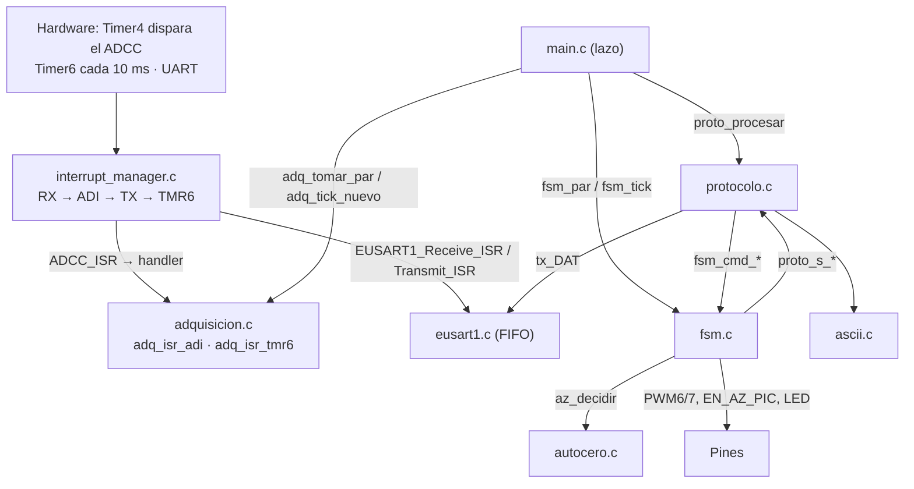
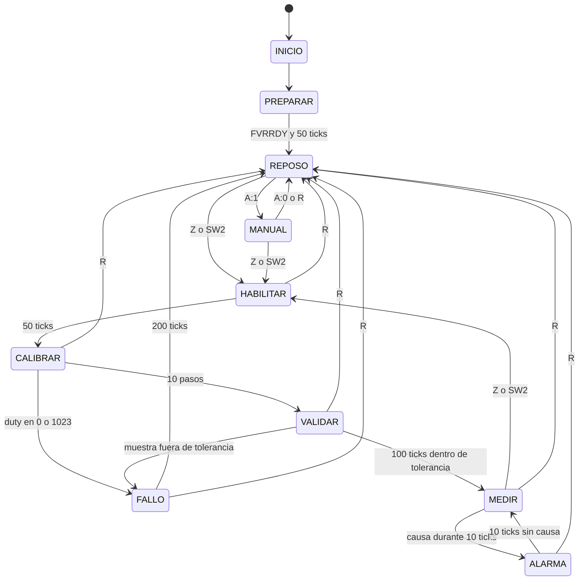

# MACRO · Cómo funciona el firmware

Para quien no escribió el código. Fuente de verdad del diseño: `docs/macro/MACRO_especificacion_diseno.md` (§7 es la arquitectura del firmware). Código en `firmware/MACRO_Firmware.X/`. Los números de línea son del commit en que se escribió este documento.

## 1. Mapa de archivos

| Archivo | Qué hace | Quién lo llama |
|---|---|---|
| `main.c` | Arranca MCC, instala los handlers, habilita interrupciones y repite un lazo: comandos → pares → ticks | (reset) |
| `adquisicion.c/.h` | Contiene los dos handlers que se ejecutan **dentro de la ISR** (ADI y TMR6), publica los pares I/Q y entrega los ticks. También arranca Timer4 y lee FVRA2X del DIA | `main.c`, `fsm.c`; el hardware (vía `interrupt_manager.c`) |
| `fsm.c/.h` | Máquina de estados de §7.3, LED, antirrebote de SW2 y los comandos que cambian el estado | `main.c`, `protocolo.c` |
| `autocero.c/.h` | Aproximación sucesiva de 10 bits. Es lógica pura: no toca registros | `fsm.c` |
| `protocolo.c/.h` | Arma todo el texto hacia el PC (datos, `S:`, `OK:`, `E:`) e interpreta los comandos del PC | `main.c`, `fsm.c`; llama a `fsm.c` y `ascii.c` |
| `ascii.c/.h` | Entero ↔ texto a mano, sin `printf`/`sprintf`/`scanf` | `protocolo.c` |
| `mcc_generated_files/` | Código de MCC (no se regenera). Se usa `eusart1.c` (`tx_DAT`, `EUSART1_Read`), `pwm6/7.c`, `tmr4.c`, `fvr.c`, `pin_manager.h` | todos |

**Un detalle importante.** El ISR no formatea ni decide nada. Todo lo "inteligente" ocurre en el lazo de `main.c`, que recibe los datos ya copiados por la ISR.

El lazo de `main.c` hace, en este orden y sin esperar:
1. `proto_procesar()`: lee lo que haya en la FIFO de RX.
2. Mientras haya un par nuevo (`adq_tomar_par`): lo envía con `proto_datos` y se lo da a `fsm_par`.
3. Mientras haya un tick de 10 ms sin atender (`adq_tick_nuevo`): `fsm_tick()`.

## 2. La ISR

Una sola ISR, `INTERRUPT_InterruptManager` en `mcc_generated_files/interrupt_manager.c` (cambio C-11 en `docs/revision_codigo_mcc.md`). Cada rama comprueba habilitación **y** bandera.

| Orden | Rama | Qué ejecuta (archivo · función) | Qué hace |
|---|---|---|---|
| 1 | RX | `eusart1.c` · `EUSART1_Receive_ISR()` | Guarda el byte recibido en la FIFO de RX |
| 2 | ADI | `adcc.c` · `ADCC_ISR()` → `adquisicion.c` · `adq_isr_adi()` (línea 26) | Ver abajo |
| 3 | TX | `eusart1.c` · `EUSART1_Transmit_ISR()` | Pasa el siguiente byte de la FIFO a `TX1REG` o apaga `TX1IE` |
| 4 | TMR6 | `tmr6.c` · `TMR6_ISR()` → `adquisicion.c` · `adq_isr_tmr6()` (línea 66) | `ticks_isr++` |

**`adq_isr_adi`** hace solo lo de la regla 10 de `CLAUDE.md`:
1. Lee `ADPCH` para saber qué canal terminó.
2. Copia `ADRES`.
3. Lee y borra `ADTIF` (saturación detectada por el hardware).
4. Escribe en `ADPCH` el otro canal.
5. Si terminó Q y antes había llegado I, publica el par (`pub_i`, `pub_q`, `pub_sat`) e incrementa `pub_seq`. Si el orden no es I → Q, cuenta el par como descartado.

**Por qué ese orden.** Es el orden de la §6.12, y se justifica por el plazo de cada fuente:
- RX va primero porque su plazo es el más corto: ~174 µs antes de perder un byte (2 bytes de FIFO a 87 µs/byte).
- ADI va segundo: 931 µs hasta el siguiente disparo de Timer4.
- TX va tercero: no tiene plazo, solo pierde caudal.
- TMR6 va último: 10 ms.

La cadena es `if / else if`. Cada entrada a la ISR atiende una sola fuente. Si hay varias pendientes, las demás esperan a la siguiente entrada, en ese orden de prioridad.

La lectura de un par desde `main.c` (`adq_tomar_par`, línea 100) se protege con el contador `pub_seq`: si la ISR publica a mitad de la copia, se repite la lectura. Si `main` tarda tanto que la ISR publica dos pares, se cuenta uno como perdido.

## 3. La máquina de estados

Los tiempos están en ticks de Timer6 (1 tick = 10 ms). Nada bloquea.

`R` vale en todos los estados salvo INICIO y PREPARAR (responde `E:estado`: el ADC todavía no arrancó). Para no llenar el diagrama, `R` desde HABILITAR, CALIBRAR, VALIDAR, MEDIR, ALARMA y FALLO aparece como líneas aparte.

| Estado | Al entrar (`entrar`, `fsm.c:133`) | Mientras está (`fsm_tick`, `fsm.c:256`) | Otros puntos de `fsm.c` |
|---|---|---|---|
| INICIO | `fsm_iniciar` (l. 179): `EN_AZ_PIC` = 0, PWM 512/512, Timer4 parado | l. 270: pasa a PREPARAR | — |
| PREPARAR | — | l. 274: espera `FVRRDY` y 50 ticks; entonces envía `S:MACRO`, `adq_arrancar()` (ADPCH = ANC0, borra banderas, arranca Timer4) | — |
| REPOSO | l. 140: `EN_AZ_PIC` = 0, `S:REPOSO` | l. 282: SW2 → HABILITAR | `fsm_cmd_z`, `fsm_cmd_a`, `fsm_cmd_p` |
| MANUAL | l. 144: `EN_AZ_PIC` = 1, `S:MANUAL` | l. 282: SW2 → HABILITAR | `fsm_cmd_p` mueve el duty en vivo |
| HABILITAR | l. 148: duty 512/512, `EN_AZ_PIC` = 1, `S:CAL` | l. 289: 50 ticks → CALIBRAR | — |
| CALIBRAR | l. 153: `az_iniciar`, duty de prueba 512 | l. 295: al cumplirse 50 ticks marca `cal_esperando` | `fsm_par` (l. 355): con la siguiente muestra llama a `az_decidir`, aplica el nuevo duty y envía `S:CAL`. Tras el paso 10 pasa a VALIDAR, o a FALLO si algún duty quedó en 0 o 1023 |
| VALIDAR | l. 160: — | l. 301: tras 100 ticks → MEDIR | `fsm_par`: cada par debe estar dentro de ±`AZ_TOL_CODIGOS` del 2048; si no → FALLO `RESIDUO` |
| MEDIR | l. 162: `S:MEDIR,dI,dQ,resI,resQ` | l. 307: SW2 → HABILITAR; una causa durante 10 ticks seguidos → ALARMA | `evaluar_causa` (l. 115) |
| ALARMA | l. 165: `S:ALARMA,<causa>` | l. 324: 10 ticks sin causa → MEDIR; si cambia la causa re-avisa (máx. 1/s) | — |
| FALLO | l. 169: `EN_AZ_PIC` = 0, duty 512/512, `S:FALLO,<causa>` | l. 341: tras 200 ticks → REPOSO | — |

Detalles que conviene saber:
- **`EN_AZ_PIC` (RC2).** Vale 0 al arrancar. Pasa a 1 en MANUAL y HABILITAR, y se mantiene en 1 en CALIBRAR, VALIDAR, MEDIR y ALARMA. Vuelve a 0 en REPOSO y FALLO (regla 11).
- **Causas de ALARMA** (`evaluar_causa`): `SIN_SENAL` (ambos canales ≤ 7), `SAT_I`, `SAT_Q` (el ADCC marcó `ADTIF`) y `TXOVR` (una línea de datos no cupo en la FIFO de TX).
- **Residuos de `S:MEDIR`.** Son el error de la **última muestra** de VALIDAR respecto de 2048. No se promedia nada en el PIC.
- **LED** (`led_actualizar`, l. 190): fase de 0 a 99 ticks. 1 Hz en PREPARAR/REPOSO, 2 Hz en MANUAL, 4 Hz en HABILITAR/CALIBRAR/VALIDAR, fijo en MEDIR, doble destello en ALARMA, 8 Hz en FALLO.
- **SW2** (`boton_evento`, l. 235): se acepta con 3 ticks seguidos en 0 (30 ms) y hay que soltarlo antes de aceptar otra pulsación. Hace lo mismo que el comando `Z`.

## 4. El auto-cero

Archivo `autocero.c`, usado por `fsm.c`. Busca, para I y Q a la vez, el duty de 10 bits que deja el código del ADC en 2048 (1,024 V).

Funciones: `az_iniciar`, `az_duty_i/q` (duty a aplicar), `az_decidido_i/q` (duty ya decidido) y `az_decidir` (cierra un paso).

Paso a paso:
1. `az_iniciar()` pone los valores decididos en 0 y el contador de pasos en 0.
2. El duty de prueba de cada paso es `decidido | bit`, empezando por el bit 9. En el primer paso vale 512 (el neutro).
3. La FSM aplica ese duty a PWM6/PWM7 y espera 50 ticks (500 ms) para que se asienten los filtros.
4. Pasados los 50 ticks, el **siguiente par** que publica la ISR se pasa a `az_decidir(codigo_i, codigo_q)`.
5. `az_decidir` calcula `error = código − 2048`. Si `SIGNO × error > 0`, el código sigue alto y hace falta más duty: **conserva el bit**. Si no, lo descarta. Lo hace por separado para I y Q.
6. Se repite con el bit 8, el 7, … hasta el bit 0: 10 pasos, 5 s.
7. Tras el paso 10, `az_decidir` devuelve `true` y la FSM pasa a VALIDAR (o a FALLO si algún duty quedó en 0 o 1023).

Ejemplo (I, SIGNO = +1): código 2400 con duty 512 → error +352 → conserva el bit 9; el siguiente paso prueba 768. Código 1900 → error −148 → descarta el bit 8 y prueba 640. Así hasta el bit 0.

Constantes (en `autocero.h`) con valor de partida **pendiente de la prueba V8**:

| Constante | Valor de partida | Cuándo se confirma |
|---|---|---|
| `AZ_GANANCIA_G` | 20 | V8 (ganancia de práctica 2) |
| `AZ_SIGNO_I`, `AZ_SIGNO_Q` | +1 | V8 |
| `AZ_TOL_CODIGOS` | 36 + 10 = 46 (se calcula desde G) | V8 |

Decisión de diseño: el error se calcula en software a partir de `ADRES` (código − 2048) y no con `ADERR`. El resultado es el mismo y la ISR sigue copiando solo `ADRES`, como pide la regla 10.

## 5. El protocolo ASCII (115 200 8N1)

Todo se arma en `protocolo.c` con las rutinas de `ascii.c` y se encola con `tx_DAT` (sin esperas, todo o nada).

### PIC → PC

| Tipo | Cuándo | Ejemplo | Dónde se arma |
|---|---|---|---|
| Datos | Cada par (500/s) | `2051,2046\r\n` | `proto_datos` |
| Arranque | Una vez, al final de PREPARAR | `S:MACRO,FVR=2047\r\n` | `proto_s_macro` |
| Estado | Al entrar a REPOSO, MANUAL o HABILITAR | `S:REPOSO\r\n`, `S:MANUAL\r\n`, `S:CAL\r\n` | `proto_s_estado` |
| Progreso de calibración | Al cerrar cada paso | `S:CAL,4,544,496\r\n` (paso, duty I decidido, duty Q decidido) | `proto_s_cal` |
| Medida | Al entrar a MEDIR | `S:MEDIR,541,497,+6,-3\r\n` | `proto_s_medir` |
| Alarma | Al entrar a ALARMA (máx. 1/s) | `S:ALARMA,SAT_Q\r\n` | `proto_s_alarma` |
| Fallo | Al entrar a FALLO | `S:FALLO,LIM_I\r\n` | `proto_s_fallo` |
| Respuesta a comando | Tras cada comando | `OK:I,534\r\n`, `OK:Z\r\n`, `E:rango\r\n` | `responder_resultado`, `responder_error_comando` (llamadas desde `ejecutar`) |
| Respuesta a `P?` | Tras `P?` | `P:I,534,Q,512\r\n` | `responder_p_consulta` |

La línea de datos no lleva ceros a la izquierda (`541,497`). Mide como máximo 11 bytes, que es lo que usa el cálculo del 48,1 % de carga.

### PC → PIC (cada comando termina en `\n`; se ignora `\r`)

| Comando | Válido en | Respuesta |
|---|---|---|
| `Z` | REPOSO, MANUAL, MEDIR | `OK:Z` → HABILITAR (igual que SW2) |
| `R` | Todos menos INICIO y PREPARAR | `OK:R` → REPOSO |
| `A:1` / `A:0` | REPOSO / MANUAL | `OK:A,1` / `OK:A,0` |
| `P:I,n` / `P:Q,n` | REPOSO, MANUAL | `OK:I,n` / `OK:Q,n` (n de 0 a 1023) |
| `P?` | Todos | `P:I,n,Q,m` |

Errores:
- `E:cmd`: no se reconoce el comando, tiene un formato incorrecto o la línea es demasiado larga.
- `E:estado`: el comando no vale en el estado actual.
- `E:rango`: n fuera de 0–1023.

El intérprete es `ejecutar` (`protocolo.c:122`), y `proto_procesar` (l. 147) arma la línea byte a byte con `EUSART1_Read`.

## 6. Cómo probar esto en banco

Equipo: placa Micro 3 con el PIC16F18446, SNAP, un terminal serie a 115 200 8N1 (PuTTY o serialplot) y un osciloscopio. El proyecto compila con XC8 2.40 y MPLAB X 6.00.

**1. Arranca**
1. Programar con SNAP y abrir el terminal.
2. En unos 0,5 s debe aparecer `S:MACRO,FVR=<mV>` (≈ 2048) seguido de `S:REPOSO`. A partir de ahí debe llegar un flujo de líneas `IIII,QQQQ`.
3. El LED parpadea a 1 Hz.
4. Con el osciloscopio en TP_PIC_8 (RC6) debe haber 1 kHz. En TP_PIC_9 (RC7) un pulso de ~70 µs por flanco (prueba V2).
5. Contar las líneas por segundo: deben ser ≈ 500.

**2. Calibra**
1. Con la sonda sobre una zona sana, pulsar SW2 o enviar `Z`.
2. Debe aparecer `OK:Z`, `S:CAL`, y luego diez líneas `S:CAL,n,dI,dQ` (n de 1 a 10) espaciadas ~0,5 s. El LED pasa a 4 Hz.
3. Al terminar, `S:MEDIR,dI,dQ,rI,rQ` y el LED queda fijo.
4. Comprobar que `rI` y `rQ` caen dentro de ±46 (valor de partida, depende de G).

**3. Mide**
1. En MEDIR los códigos `IIII,QQQQ` deben estar cerca de 2048.
2. Desconectar J2: debe aparecer `S:ALARMA,SIN_SENAL` tras ~100 ms. Al reconectar, `S:MEDIR,...` otra vez.
3. Si la calibración no converge, debe aparecer `S:FALLO,LIM_I`, `LIM_Q` o `RESIDUO`, el LED parpadea a 8 Hz durante 2 s y vuelve a `S:REPOSO`.

**4. Comandos**
- `P?` → `P:I,512,Q,512`.
- `A:1` → `OK:A,1`, `S:MANUAL`, LED a 2 Hz. `P:I,540` → `OK:I,540`. `A:0` → `OK:A,0`, `S:REPOSO`.
- `P:I,2000` → `E:rango`. `X` → `E:cmd`. `A:0` en REPOSO → `E:estado`.

**5. Valores que hay que fijar con el banco** (ver §13 del documento de diseño)
- V8: signo y ganancia (`AZ_SIGNO_I/Q`, `AZ_GANANCIA_G` en `autocero.h`). Con el signo equivocado la calibración termina en FALLO `LIM_x`.
- V3: unidad de `ADACQ` (configuración de MCC, no hay constante propia en este firmware).
- Umbral de BORV: se lee en MCC, no hay constante propia en este firmware.
